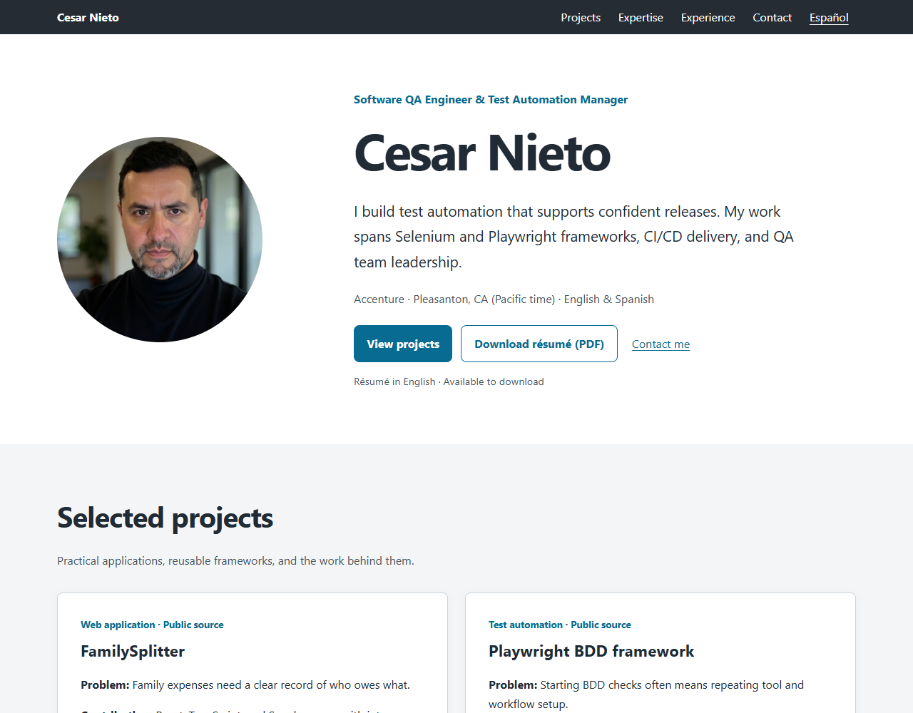

# Cesar Nieto — Personal portfolio

A bilingual portfolio presenting Cesar Nieto's software QA and test automation work. This repository contains the static website source and downloadable résumés.

**Explore:** [English website](https://cesarnieto.me/) · [Sitio en español](https://cesarnieto.me/es/) · [English résumé (PDF)](downloads/cesar-nieto-en.pdf)



## For recruiters and reviewers

- **Professional focus:** test automation management, Selenium and Playwright frameworks, Saviynt IAM testing, and CI/CD delivery.
- **Working languages:** English and Spanish.
- **Contact:** [cesar.nieto@outlook.com](mailto:cesar.nieto@outlook.com).
- **Profiles:** [LinkedIn](https://www.linkedin.com/in/cesarnpadilla) and [GitHub](https://github.com/CesarNPadilla).
- **Résumés:** [English PDF](downloads/cesar-nieto-en.pdf), [English text](downloads/cesar-nieto-en.txt), and [Spanish text](downloads/cesar-nieto-es.txt). Both website download buttons serve the English PDF.

Featured work includes [FamilySplitter](https://github.com/CesarNPadilla/FamilySplitter), a [Playwright BDD framework](https://github.com/CesarNPadilla/automation-playwright-framework), a proprietary Saviynt IAM framework, and this portfolio. The proprietary Java/Selenium framework is available by [demo and private repository access request](mailto:cesar.nieto@outlook.com?subject=Saviynt%20IAM%20framework%20demo%20request).

## Run locally

Prerequisites: Git, a browser, and Python 3. Python is a convenient preview server; the website itself requires no installation or build step.

From the directory where you keep projects:

```powershell
git clone https://github.com/CesarNPadilla/CesarNieto.me.git
cd CesarNieto.me
python -m http.server 8000 --bind 127.0.0.1
```

If you already have a checkout, open a terminal in the repository root and run only the server command. On Windows, use `py` instead of `python` if needed; on macOS or Linux, use `python3`.

Open the [English preview](http://localhost:8000/) and [Spanish preview](http://localhost:8000/es/). Both should load the portrait, navigation, and shared styles. Stop the server with `Ctrl+C`. An editor's static preview server can also serve the repository root.

## Implementation

The site uses static HTML and one shared CSS stylesheet, with no backend, database, or required environment configuration. Contact links open the visitor's email application.

- Separate English and Spanish pages with reciprocal language links.
- Responsive CSS Grid and Flexbox layouts.
- Automatic light/dark styling based on system preference.
- Semantic sections, a keyboard skip link, visible focus styles, and reduced-motion support.
- AVIF and WebP portrait sources with a JPEG fallback.
- Page descriptions, canonical URLs, language alternatives, Open Graph metadata, and Person structured data.
- An English PDF résumé and UTF-8 text résumés in both languages.

The QA tools in the professional profile describe Cesar's work. This portfolio repository has no Selenium or Playwright test suite or CI workflow.

The design is adapted from **Miniport by HTML5 UP**. Retained template JavaScript, icon fonts, and the original stylesheet are not loaded by the current pages.

## Repository guide

| Path                                                                                   | Purpose                                                     |
| -------------------------------------------------------------------------------------- | ----------------------------------------------------------- |
| [index.html](index.html)                                                               | English page and metadata                                   |
| [es/index.html](es/index.html)                                                         | Spanish page and metadata                                   |
| [assets/css/site.css](assets/css/site.css)                                             | Shared styles, themes, and responsive behavior              |
| `images/portrait.*`                                                                    | AVIF, WebP, and JPEG portrait variants                      |
| [images/readme-preview.png](images/readme-preview.png)                                 | Current English desktop preview for this README             |
| [downloads/](downloads/)                                                               | English PDF and English/Spanish text résumés                |
| [CNAME](CNAME)                                                                         | Custom domain: `cesarnieto.me`                              |
| [.nojekyll](.nojekyll)                                                                 | Disables Jekyll processing on GitHub Pages                  |
| [.agents/skills/professional-markdown/](.agents/skills/professional-markdown/SKILL.md) | Project documentation skill, references, and starter assets |
| [SITE_UPDATE.md](SITE_UPDATE.md)                                                       | Historical update notes and verification records            |
| [LICENSE.txt](LICENSE.txt)                                                             | Template license terms                                      |
| [README.txt](README.txt)                                                               | Original Miniport documentation and credits                 |

Other files under `assets/` and `images/` include retained template assets. Check page references before removing them. For code review, start with the two HTML pages and `assets/css/site.css`; historical source snapshots in `SITE_UPDATE.md` may be outdated.

## Update the website

1. **Keep both languages current.** Update profile, employment dates, responsibilities, skills, projects, and contact details together in `index.html` and `es/index.html`. Translate metadata, image alternatives, and accessibility labels as well as visible text.
2. **Keep claims precise.** Preserve the scope and estimate labels of reported outcomes. The estimated 70% reduction in design and coding effort applies to the Saviynt Playwright framework. Keep public project links and private demo availability accurate.
3. **Synchronize the résumés.** Update `downloads/cesar-nieto-en.txt`, `downloads/cesar-nieto-es.txt`, and `downloads/cesar-nieto-en.pdf` when career information changes. Save text files as UTF-8 and inspect the PDF after replacing it. Update both HTML pages and this README if filenames, formats, or download languages change.
4. **Edit active styles.** Use `assets/css/site.css`; `:root` variables define the palette, and media queries handle dark mode, small screens, and reduced motion. The original `main.css` and Sass files do not control the pages.
5. **Update image variants together.** Generate all three portrait formats from the same image, retain descriptive alternatives, and keep HTML and Open Graph dimensions accurate. Refresh `images/readme-preview.png` when the visible design or introduction changes.
6. **Align links and metadata.** Keep email/profile links and Person structured data current. For domain changes, update `CNAME`, canonical URLs, `hreflang`, `og:url`, `og:image`, and structured-data URLs in both pages. English pages use `./` paths; Spanish pages use `../` for shared assets.

## Verify changes

Run the local server, then check:

- **Content:** both languages, project links, contact links, and language switching.
- **Layout:** mobile and desktop widths, 200% browser zoom, and light/dark system themes; look for unreadable text and horizontal overflow.
- **Keyboard:** the skip link, visible focus, navigation, contact links, and downloads.
- **Motion:** reduced-motion preference disables animated anchor scrolling.
- **Files:** the portrait, stylesheet, English PDF, English text résumé, and Spanish text résumé load successfully. Inspect the PDF and check the browser console/network panel for errors.
- **Metadata:** titles, descriptions, canonical/language URLs, and structured data match any identity or domain changes.

From the repository root, inspect unintended placeholders and review the changes:

```powershell
Select-String -Path index.html, es/index.html, downloads/*.txt -Pattern '\[CONFIRM\]', '\bdraft\b', '\bpending\b', '\bprovisional\b'
git diff --check
git diff
```

Investigate any search matches in context. `git diff --check` should produce no output. Review new files with `git status --short` as well; `git diff` does not show untracked file contents.

Earlier browser checks are recorded in `SITE_UPDATE.md`. They do not establish that later revisions pass these checks or constitute a full accessibility audit.

## Publish

The repository can be served by a static host without a build step. The checked-in `CNAME` and page metadata use `cesarnieto.me`. The publishing branch, DNS provider, and HTTPS settings are external configuration; confirm them in the hosting and DNS accounts.

For a branch-based GitHub Pages deployment:

1. Complete the local verification above.
2. Commit and push the intended site files, including shared assets, downloads, `CNAME`, `.nojekyll`, and license information.
3. In the repository's Pages settings, select the intended publishing branch and root folder.
4. Configure the custom domain, DNS records, and HTTPS to match `CNAME` and the page metadata.
5. Repeat the relevant content, asset, navigation, and download checks on the deployed English and Spanish pages.

For repository-subpath hosting, update absolute metadata URLs to include the deployment subpath and configure the domain files for that host.

## Attribution and license

Adapted from **Miniport by HTML5 UP**, under the **Creative Commons Attribution 3.0** terms in [LICENSE.txt](LICENSE.txt). Preserve the visible HTML5 UP credit and license links when updating or redistributing the adapted site. Original template credits remain in [README.txt](README.txt).
